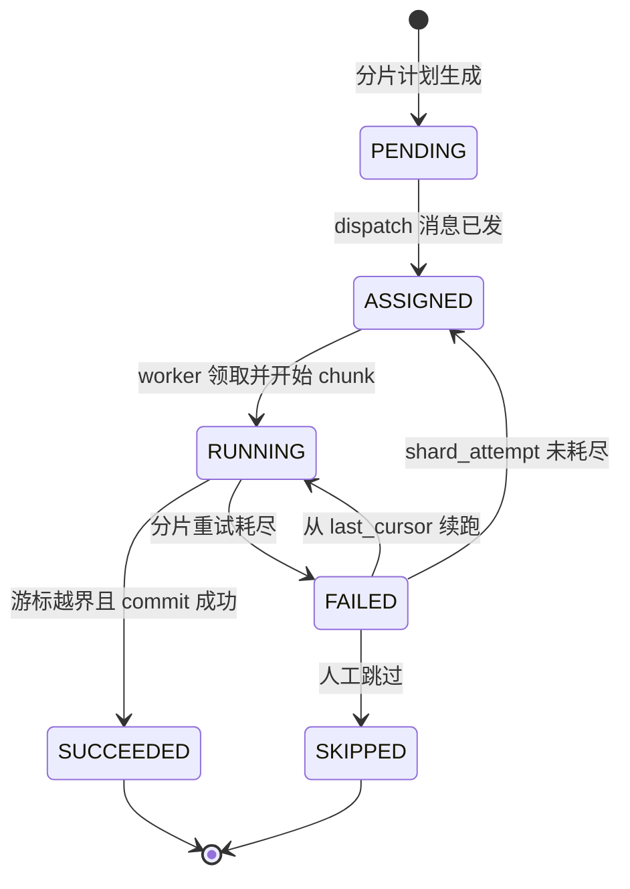
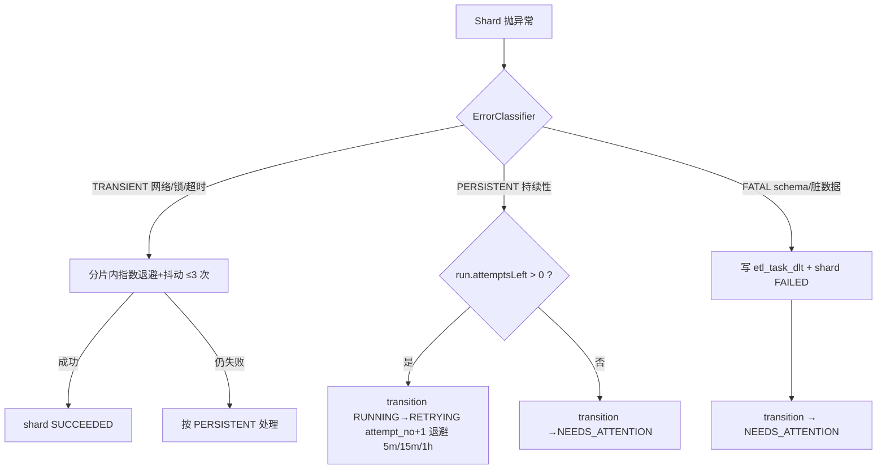
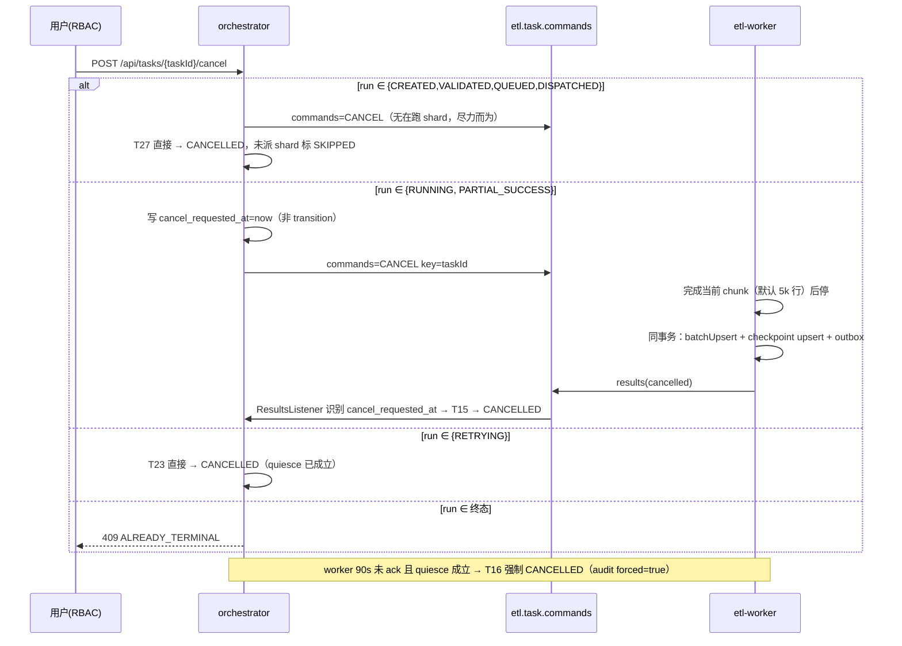

# ETL Orchestrator 详细设计：状态机、编排与失败处置

> 文档定位：`etl-architecture-evolution-plan.md §3/§4` 的**实施级详细设计**（target-state）。
> 消费方：Phase 1（`EtlTaskStatus` + `etl_task_run` + `transition()`）与 Phase 2（DLT + Outbox + `/retry` `/cancel`）的编码与评审。
> 上游证据基线：代码 `task-management-service`、`data-extraction-service`、`data-storage-service`；DDL `db/schema/02-create-tables.sql`；配置 `config-server/src/main/resources/config-repo/task-management-service.yml`。
> 配套图：`target-lifecycle-states.dot`（本设计对其做 9 处边的修订，差异见 §8.2）。
> 外部参照：`mainstream-etl-task-state-patterns.md`（业界数据接入系统的任务状态判定方式对照）。该文档仅用于说明本文 §1 各原则的出处与共性来源，**不构成约束、不纳入评审基线**；与之相反的表述一律以本文与演进方案为准。
> 约定：本文所有代码均为**待实现规范**，非现状；凡与现状不符处均以「现状 → 目标」显式标注。

---

## 1. 设计原则（评审时不得违反）

| # | 原则 | 说明 | 否决的替代做法 |
|---|---|---|---|
| P1 | **checkpoint 是唯一真源，消息只是触发器** | 完成/部分成功的判定一律由 `etl_task_checkpoint` 聚合重算；`results`/`progress` 消息只负责"唤起一次评估"，其自报统计不参与终局判定 | 信任 worker 自报 `completedRecords`（现状 C2 病根） |
| P2 | **单一迁移入口** | 所有状态变更必须经 `OrchestratorService.transition()`；实体上不再暴露 `setStatus(String)` | 现状 7 处散点 `setStatus("literal")` |
| P3 | **不变式优先落在 DB** | 能用约束/唯一索引表达的不变式（单当前 run、checkpoint 主键、attempt 唯一）不依赖代码 | 只在 Service 里判重 |
| P4 | **CAS 而非悲观锁** | 迁移用 `UPDATE ... WHERE status = :from`，避免 Kafka 消费线程持锁导致 rebalance | `SELECT FOR UPDATE` 行锁 |
| P5 | **非法迁移不可重试、必须可见** | 非法迁移 → 记指标 + 落审计 + 消息进 DLT，绝不循环重试 | 抛异常触发 `DefaultErrorHandler` 重放形成 poison loop |
| P6 | **写权单点** | 每张表只有一个写入者（见 §4.1）；跨层写需求一律通过事件 | worker 直接改 `etl_task_run.status` |
| P7 | **人工裁定不隐身** | 任何改变终局的运维动作（retry/resume/abort/宽恕）必须写 `etl_task_audit`（who/when/reason/from/to） | 直接改 DB 行 |
| P8 | **指标低基数** | 沿用 `EtlMetrics` 既有取舍：**taskId 不进指标标签**，只进日志与 DB | `etl.task.duration{taskId=...}` |

---

## 2. 三层状态模型

```
etl_task              任务定义 + 最新 run 的汇总投影（只读视图，不承载状态机）
  └─ etl_task_run     一次执行意图；状态机宿主（12 状态 + attemptNo）
       └─ etl_task_checkpoint   分片断点；shard 子状态机（6 状态）
```

- `etl_task.status` 恒等于 **current run** 的 status 投影，由 `refreshDerivedStatus()` 单向刷新，禁止反向写入。
- 自动重试在**同一 run 内** `attempt_no += 1`（保留 checkpoint 连续性）；只有人工"全量重跑"或重新 submit 才新建 run（见 D-22）。
- 流模式（`profile=stream`）复用同一套表：`stream_id` 占 `task_id` 位、常驻 run 的 `status` 只用 `RUNNING / NEEDS_ATTENTION / CANCELLED`，收敛 guard 规则不适用（见 §7.5 末）。

### 2.1 状态集合

`EtlTaskStatus`（run 层，12）：
`CREATED, VALIDATED, QUEUED, DISPATCHED, RUNNING, PARTIAL_SUCCESS, RETRYING, NEEDS_ATTENTION, SUCCEEDED, FAILED, CANCELLED, SUPERSEDED`

`EtlShardStatus`（checkpoint 层，6）：
`PENDING, ASSIGNED, RUNNING, SUCCEEDED, FAILED, SKIPPED`

`CANCELLED` 在 shard 层不复存在：取消是 run 级意图，落 checkpoint 时保留原状态并把 `etl_task_run.cancel_requested_at` 置位（见 D-18）。

---

## 3. 状态定义

图例：**驻留副作用** = 该状态下系统可做的写操作；**SLA** = 最长合法驻留时间，超时由 sweeper 处理（§6.5 规范、§7.9 判定树）。

| 状态 | 语义 | 进入条件 | 驻留期间允许的副作用 | 终态? | SLA / 超时动作 |
|---|---|---|---|---|---|
| `CREATED` | run 记录已落库，任务定义快照已固化（source/target/connectorType/分片计划版本） | `submit()` 或 `POST /retry?scope=full` 创建 run | 仅写 run 行本身 | 否 | 5s。超时未进入校验 → sweeper 重放校验链（T31） |
| `VALIDATED` | 校验通过：数据源可达、源表可读、目标表已治理（V-3 建表/补唯一键）、分片计划非空且 shard 数 ≤ 上限 | `validate()` 全部 guard 通过 | 无 | 否 | 10s。超时未 `QUEUED` → T30（`FAILED`, `ENQUEUE_STALLED`） |
| `QUEUED` | 等待派工。两种成因由 `queued_reason` 区分：`SCHEDULED`（正常排队）/ `THROTTLED`（全局令牌不足，见 D-10） | `enqueue()`；或 `DISPATCHED` 心跳超时回退 | 更新 `queued_reason`、排队位次 | 否 | `SCHEDULED` 5min / `THROTTLED` 30min。超时 → T32（`NEEDS_ATTENTION`, `DISPATCH_STARVED`） |
| `DISPATCHED` | 已发出 ≥1 条 shard 派工消息，但**尚未收到任何 worker 心跳** | `dispatch()` 成功写入首条 `etl.task.dispatch.batch` | 继续补发其余 shard（受全局许可约束） | 否 | **60s**。→ §7.9 心跳超时回退 `QUEUED` 并 `attempt_no+1` |
| `RUNNING` | 至少一个 shard 有 worker 心跳确认，run 正在执行 | 首次心跳 CAS 成功 | `last_progress_ts` 单调更新；worker 写 checkpoint | 否 | 无固定上限，但受 `EtlTaskStalled`（§10.2）约束：`now - max(last_progress_ts, checkpoint.updated_at) > 15 × 估算单 shard 耗时` → `NEEDS_ATTENTION(reason=STALLED)` |
| `PARTIAL_SUCCESS` | 收敛时存在 `FAILED` 分片且其余为 `SUCCEEDED/SKIPPED`；已提交数据保留 | 收敛算法（§7.5）判定 | 只读；等待自动重试或人工 | 否 | 24h。超时 → `NEEDS_ATTENTION(reason=PARTIAL_UNRESOLVED)` |
| `RETRYING` | 已决定任务级重试，处于退避窗口内，**无 shard 在跑**（quiesce 已确认） | 持续性错误且 `attemptsLeft > 0`；或 `PARTIAL_SUCCESS` 且 `attemptsLeft > 0` | 更新 `next_attempt_at`、`attempt_no` | 否 | 退避时长 + 5min。退避到期由 sweeper 推 `DISPATCHED`；窗口内 worker 提前上报 shard RUNNING → 视为协议违例，落 DLT |
| `NEEDS_ATTENTION` | 需人工介入：attempt 耗尽 / DLT 非空 / 卡死 / 饥饿 / 人工暂停。**可迁出但需受控 API** | §7.4 永久错误、§7.6 DLT、§7.9 各类 sweeper | 只读展示 + 允许补写 `error_summary` | 否 | 7d 无操作 → 告警升级（不自动迁移，绝不静默改终态） |
| `SUCCEEDED` | 全部分片成功且行数对账平衡 | §7.5 guard G-4 | 只读；可被新 run 取代为 `SUPERSEDED` | **是** | — |
| `FAILED` | 系统判定不可能成功，或人工放弃失败任务 | §7.1 校验失败（T3）、`NEEDS_ATTENTION` 经 `/abort`（T26）、run 级 fatal 且 DLT 为空（T14） | 只读 | **是** | — |
| `CANCELLED` | 用户主动取消且已停止；已提交数据与 checkpoint 保留 | §7.7 取消确认（T15/T16/T27） | 只读；如需继续执行走 `POST /retry?scope=full`（**新建 run**，不复活终态，见 D-02/D-18） | **是** | — |
| `SUPERSEDED` | **仅 run 层存在**：该 run 曾是终态，被同 task 的新 run 取代，不再是 task 视图的引用对象 | §5.1 T1（§7.1 新建 run）时归档旧终态 run | 只读 | **是** | — |

### 3.1 关键概念边界（避免语义混装）

现状把三种语义全塞进一个 `failed`，是 D4/D3 难做的根因。目标态的分工：

| 场景 | 现状 | 目标态 |
|---|---|---|
| 任务定义不合法（源表不存在、凭据失败） | 卡在 `running` 或 `failed` | `FAILED`（不可重试，`error_summary.errorClass=FATAL_CONFIG`） |
| 脏数据/单行解析失败 | 吞异常或整任务 `failed` | 该行进 `etl_task_dlt`，shard → `FAILED`，run → `NEEDS_ATTENTION` |
| 部分分片失败、其余成功 | `failed`（已成功数据无痕） | `PARTIAL_SUCCESS`（数据保留 + 可只重跑失败分片） |
| 派工后无 worker | `running` 永久卡死 | `DISPATCHED` 60s → 回退 `QUEUED` + `attempt_no+1` |
| 用户主动取消 | 无此能力 | `CANCELLED` |

---

## 4. 数据模型与写权

### 4.1 写权矩阵（P6 的执行依据）

| 表 | 唯一写入者 | 其他角色 |
|---|---|---|
| `etl_task` | orchestrator | worker 只读（取 targetTableName 等，走缓存） |
| `etl_task_run` | orchestrator（`transition` 内部） | worker **禁止写**，只能经 `results` 请求收敛 |
| `etl_task_checkpoint` | **worker**（与目标表写入同一本地事务） | orchestrator 只读聚合；仅 `/retry?scope=failed-shards`、`/abort`、`/mark-succeeded-with-data-loss` 可改 `status` |
| `etl_task_dlt` | worker（DLT 落表） | orchestrator 消费 `etl.task.dlt` 后只读并触发 `NEEDS_ATTENTION` |
| `etl_task_audit` | orchestrator | 运维只读 |
| `etl_outbox` | worker（progress/results/dlt 事件）+ orchestrator（commands/dispatch 事件） | poller 单线程投递并删除 |

> checkpoint 由 worker 直写的事实，是"数据 + 断点 + 事件"三者原子提交的基础（P1）；也意味着 orchestrator 与 worker **共享同一 PG 实例**（现状 `jdbc:postgresql://localhost:5433/etl_system`，见 `task-management-service.yml:8`），跨库部署时此假设必须重新评审。
>
> **说明（解释性，不构成新增约束）**：「worker 直写状态表」与 DolphinScheduler 的 Worker 更新 `t_ds_task_instance.state` 同构，代价也相同——控制面与数据面的可用性被绑在同一个 DB 上。Flink / SeaTunnel 之所以能把状态搬离业务库，是因为它们另有独立 checkpoint 存储与 barrier 协议；本设计两者皆无（见 §7.5 语义边界说明），因此不能照搬引擎类的部署模型。参见 `mainstream-etl-task-state-patterns.md §2.1 / §5`。

### 4.2 DDL 规范（Phase 1 交付 `05-etl-task-run.sql`、`06-etl-task-checkpoint.sql`；Phase 2 交付 `07-etl-task-dlt.sql`、`08-etl-task-audit.sql`、`09-etl-outbox.sql`）

沿用 `db/schema` 既有风格：`SERIAL PRIMARY KEY` + `COMMENT ON COLUMN`（参考 `03-user-management-tables.sql`）。

```sql
-- 05-etl-task-run.sql
CREATE TABLE IF NOT EXISTS etl_task_run (
    id              BIGSERIAL PRIMARY KEY,
    run_id          VARCHAR(64)  NOT NULL UNIQUE,           -- UUID，D-21
    task_id         VARCHAR(64)  NOT NULL REFERENCES etl_task(task_id) ON DELETE CASCADE,
    attempt_no      INT          NOT NULL DEFAULT 1,        -- 同一 run 内任务级重试次数
    status          VARCHAR(20)  NOT NULL,                  -- EtlTaskStatus 枚举名
    is_current      BOOLEAN      NOT NULL DEFAULT TRUE,
    queued_reason   VARCHAR(20),                            -- SCHEDULED | THROTTLED
    shard_total     INT          NOT NULL DEFAULT 0,
    shard_succeeded INT          NOT NULL DEFAULT 0,
    shard_failed    INT          NOT NULL DEFAULT 0,
    shard_skipped   INT          NOT NULL DEFAULT 0,
    rows_in         BIGINT       NOT NULL DEFAULT 0,
    rows_out        BIGINT       NOT NULL DEFAULT 0,
    rows_dropped    BIGINT       NOT NULL DEFAULT 0,        -- 与 etl_records_dropped_total 同口径（D-08）
    rows_deduped    BIGINT       NOT NULL DEFAULT 0,        -- ON CONFLICT 命中，不参与对账等式
    next_attempt_at TIMESTAMP,                              -- RETRYING 退避到期时间
    dispatched_at   TIMESTAMP,                              -- 心跳超时判定基线
    last_progress_ts TIMESTAMP,                             -- 卡死判定基线
    cancel_requested_at TIMESTAMP,                          -- 软取消标记（D-18）
    started_at      TIMESTAMP,
    finished_at     TIMESTAMP,
    error_summary   TEXT,                                   -- 首个致命异常 stack 前 2KB + shard 列表
    created_at      TIMESTAMP DEFAULT CURRENT_TIMESTAMP,
    updated_at      TIMESTAMP DEFAULT CURRENT_TIMESTAMP,
    CONSTRAINT ck_run_status CHECK (status IN (
        'CREATED','VALIDATED','QUEUED','DISPATCHED','RUNNING','PARTIAL_SUCCESS',
        'RETRYING','NEEDS_ATTENTION','SUCCEEDED','FAILED','CANCELLED','SUPERSEDED'))
);
COMMENT ON TABLE etl_task_run IS 'ETL 执行实例（一次执行意图），状态机宿主';
COMMENT ON COLUMN etl_task_run.attempt_no IS '同一 run 内的任务级重试序号；新建 run 归 1';
COMMENT ON COLUMN etl_task_run.rows_deduped IS '幂等命中数（重放场景），不计入对账等式';

CREATE UNIQUE INDEX IF NOT EXISTS ux_run_task_current
    ON etl_task_run (task_id)
    WHERE is_current AND status NOT IN ('SUCCEEDED','FAILED','CANCELLED','SUPERSEDED');
CREATE UNIQUE INDEX IF NOT EXISTS ux_run_task_attempt
    ON etl_task_run (task_id, attempt_no)
    WHERE is_current;   -- 仅限当前 run：T1「新建 run 归 1」意味着历史 run 之间 attempt_no 必然重复
CREATE INDEX IF NOT EXISTS idx_run_status_progress ON etl_task_run (status, last_progress_ts);
CREATE INDEX IF NOT EXISTS idx_run_dispatched ON etl_task_run (status, dispatched_at);
```

`ux_run_task_current` 用部分唯一索引把 INV-1（同一 task 至多一个非终态当前 run）交给 DB 强制——P3。

```sql
-- 06-etl-task-checkpoint.sql
CREATE TABLE IF NOT EXISTS etl_task_checkpoint (
    id            BIGSERIAL PRIMARY KEY,
    task_id       VARCHAR(64) NOT NULL,
    run_id        VARCHAR(64) NOT NULL REFERENCES etl_task_run(run_id) ON DELETE CASCADE,
    shard_id      VARCHAR(32) NOT NULL,
    status        VARCHAR(16) NOT NULL DEFAULT 'PENDING',   -- EtlShardStatus
    shard_attempt INT         NOT NULL DEFAULT 0,           -- 分片级重试次数（与 run.attempt_no 解耦，D-11）
    last_cursor   TEXT,                                     -- JDBC: pk 上界；Mongo: _id；File: 行区间+offset；Stream: topic-partition:offset
    last_pk       VARCHAR(128),
    pk_from       BIGINT,                                   -- 分片主键闭区间下界（validate/T2 由编排器写入，供 §7.2 派工）
    pk_to         BIGINT,                                   -- 分片主键闭区间上界（非 JDBC 源可空）
    rows_in       BIGINT      NOT NULL DEFAULT 0,           -- 累计单调不减（D-08）
    rows_out      BIGINT      NOT NULL DEFAULT 0,
    rows_dropped  BIGINT      NOT NULL DEFAULT 0,
    rows_deduped  BIGINT      NOT NULL DEFAULT 0,
    error_class   VARCHAR(24),                              -- TRANSIENT | PERSISTENT | FATAL
    error_detail  TEXT,
    updated_at    TIMESTAMP   NOT NULL DEFAULT CURRENT_TIMESTAMP,
    CONSTRAINT ck_checkpoint_status CHECK (
        status IN ('PENDING','ASSIGNED','RUNNING','SUCCEEDED','FAILED','SKIPPED')),
    CONSTRAINT ck_checkpoint_rows CHECK (rows_out + rows_dropped <= rows_in)
);
COMMENT ON COLUMN etl_task_checkpoint.rows_in IS '跨 attempt 累计实读行数，禁止覆盖式回退';

CREATE UNIQUE INDEX IF NOT EXISTS ux_checkpoint_shard ON etl_task_checkpoint (task_id, run_id, shard_id);
CREATE INDEX IF NOT EXISTS idx_checkpoint_run_status ON etl_task_checkpoint (run_id, status);
```

`ck_checkpoint_rows` 把"对账等式"下推到行级：单分片绝不可能写出比读取更多的行，让 P1 的聚合等式在源头就有兜底。

### 4.3 checkpoint 子状态机



分片级不变式：`SUCCEEDED` 后不得回到任何在跑状态（人工"重跑指定分片"例外，须走 `POST /retry?shards=...&force=true` 并写 audit）。

---

## 5. 迁移规则

### 5.1 迁移全表（穷举，评审基线）

`触发者` 列：ORCH=编排 API/scheduler，WRK=worker 消息，SWP=sweeper，HUM=人工受控 API。

| # | From → To | 触发者 | Guard（全部通过才允许） | 副作用（同事务） |
|---|---|---|---|---|
| T1 | (新) → `CREATED` | ORCH | 任务定义存在；INV-1 无同 task 非终态 run | 建 run（`attempt_no=1`,`is_current=TRUE`）；旧终态 run → `SUPERSEDED` |
| T2 | `CREATED` → `VALIDATED` | ORCH | 数据源可达 ∧ 源表可读 ∧ 目标表已治理（V-3 建表/唯一键） ∧ 分片计划 ∈ [1, `shard.maxTotal`] | `shard_total` 落库；批量 INSERT checkpoint(PENDING) |
| T3 | `CREATED` → `FAILED` | ORCH | 校验失败且 `errorClass=FATAL_CONFIG` | `error_summary`；`finished_at` |
| T4 | `VALIDATED` → `QUEUED` | ORCH | 全局 RUNNING 分片额度已知（不要求已获取） | `queued_reason=SCHEDULED`；audit |
| T5 | `QUEUED` → `DISPATCHED` | ORCH | 全局许可（DB 活跃分片数）≥1；首条 dispatch 消息已获 broker ack | `dispatched_at=now`；首个 shard `PENDING→ASSIGNED`；audit |
| T6 | （非迁移）`QUEUED` 标记更新 | ORCH | 令牌不足 | 仅写 `queued_reason=THROTTLED`，**不走 `transition()`**（不入迁移表计数） |
| T7 | `DISPATCHED` → `RUNNING` | WRK | 收到该 run 任一 shard 心跳；CAS `status=DISPATCHED` | `started_at=now`（仅首次）；`last_progress_ts` |
| T8 | `DISPATCHED` → `QUEUED` | SWP | `now - dispatched_at > 60s` ∧ **该 run 无 `ASSIGNED/RUNNING` shard**（quiesce 检查） ∧ `attempt_no < maxAttempts` | `attempt_no+1`；`next_attempt_at=now+backoff`；shard `ASSIGNED→PENDING`；audit |
| T9 | `DISPATCHED` → `NEEDS_ATTENTION` | SWP | 60s 无心跳 ∧ `attempt_no >= maxAttempts` | `error_summary`；DLT 关联；audit |
| T10 | `RUNNING` → `SUCCEEDED` | WRK→ORCH | **G-4**：`shard_failed=0 ∧ shard_skipped=0 ∧ 所有 shard ∈ {SUCCEEDED}` ∧ `rows_out + rows_filtered + rows_failed + rows_deduped = rows_in`（§7.5） | `finished_at`；`is_current` 保持 TRUE；audit |
| T11 | `RUNNING` → `PARTIAL_SUCCESS` | WRK→ORCH | **G-2**：`shard_failed ≥ 1` ∧ 其余 shard ∈ {`SUCCEEDED`,`SKIPPED`} | 汇总 `shard_*`；`error_summary`；audit |
| T12 | `RUNNING` → `RETRYING` | WRK | `errorClass=PERSISTENT` ∧ `attempt_no < maxAttempts` ∧ quiesce（无 shard 在跑） | `attempt_no+1`；`next_attempt_at=now+backoff(attempt)`；audit |
| T13 | `RUNNING` → `NEEDS_ATTENTION` | WRK/SWP | `errorClass=FATAL` ∨ 未 `resolved` 的 DLT 行数 > 0 ∨ `STALLED` 成立 ∨ 人工暂停标记 | `error_summary`；告警；audit |
| T14 | `RUNNING` → `FAILED` | WRK | run 级 fatal 且 DLT 为空（如目标库不可连 ∧ attempt 耗尽 ∧ 源元数据已消失） | `error_summary`；`finished_at`；audit |
| T15 | `RUNNING` → `CANCELLED` | WRK | `cancel_requested_at IS NOT NULL` ∧ worker 已确认停在 chunk 边界 ∧ checkpoint 已落 | `finished_at`；audit |
| T16 | `RUNNING` → `CANCELLED` | SWP | `cancel_requested_at < now-90s` ∧ 无 shard ∈ {`ASSIGNED`,`RUNNING`}（取消确认不可达兜底，D-18） | 同上；audit 标注 `forced=true` |
| T17 | `PARTIAL_SUCCESS` → `RETRYING` | ORCH | `attempt_no < maxAttempts`（自动重试链路） | `attempt_no+1`；仅失败 shard `FAILED→PENDING` |
| T18 | `PARTIAL_SUCCESS` → `NEEDS_ATTENTION` | SWP | 驻留 > 24h ∨ attempt 耗尽 | audit |
| T19 | `PARTIAL_SUCCESS` → `SUCCEEDED` | HUM | `POST .../mark-succeeded-with-data-loss`，**必填 reason ≥ 10 字符** + 独立权限 `etl:task:forgive` + 二次确认位 | audit（含被宽恕的 shard 列表）；`rows_dropped` 语义标注 |
| T20 | `PARTIAL_SUCCESS` → `CANCELLED` | HUM | `POST .../cancel`，承认保留已提交数据 | `finished_at`；audit |
| T21 | `RETRYING` → `DISPATCHED` | SWP | `now >= next_attempt_at` ∧ quiesce 复核 | `dispatched_at=now`；复用同 run 的 checkpoint 续派 |
| T22 | `RETRYING` → `NEEDS_ATTENTION` | WRK | 新 attempt 立即 FATAL ∧ `attempt_no >= maxAttempts` | audit |
| T23 | `RETRYING` → `CANCELLED` | HUM | `POST .../cancel`（退避窗口内取消） | `finished_at`；audit |
| T24 | `NEEDS_ATTENTION` → `QUEUED` | HUM | `POST .../retry`；默认 `scope=failed-shards,from=checkpoint` | 失败 shard `FAILED→PENDING`；`queued_reason=SCHEDULED`；audit |
| T25 | `NEEDS_ATTENTION` → `RUNNING` | HUM | `POST .../resume`；`attemptsLeft>0` ∧ 无 shard 处于 `RUNNING`（避免双跑） | `last_progress_ts=now`；**不改 `attempt_no`**；audit |
| T26 | `NEEDS_ATTENTION` → `FAILED` | HUM | `POST .../abort`，必填 reason | `finished_at`；DLT 标记 `abandoned`；audit |
| T27 | `*` → `CANCELLED`（仅非终态） | HUM | `POST .../cancel`：`CREATED/VALIDATED/QUEUED/DISPATCHED` 下无在跑 shard，直接终态 | 未派 shard 标 `SKIPPED`；`finished_at`；audit |
| T28 | `SUCCEEDED` → `SUPERSEDED` | ORCH | 同 task 新建 run（T1 内联触发）；仅 run 层 | `is_current=FALSE` |
| T29 | `FAILED`/`CANCELLED` → `SUPERSEDED` | ORCH | 同 T28（新 run 归档旧终态 run 时按旧终态分别处理） | `is_current=FALSE` |
| T30 | `VALIDATED` → `FAILED` | SWP | 驻留 > `validated-timeout(10s)` 未入队（内部错误，不可重试） | `error_summary(reason=ENQUEUE_STALLED)`；`finished_at`；audit |
| T31 | `CREATED` → `VALIDATED`（重放） | SWP | 驻留 > `created-timeout(5s)` 且校验链未执行完 | 与 T2 同副作用，`reason=VALIDATE_RETRY`；**不消耗 attempt 预算** |
| T32 | `QUEUED` → `NEEDS_ATTENTION` | SWP | `queued_reason=SCHEDULED` ∧ 驻留 > 5m；或 `queued_reason=THROTTLED` ∧ 驻留 > 30m | `error_summary(reason=DISPATCH_STARVED)`；audit |

合计：**32 条合法迁移边**（T1 为创建而非迁移、T6 为标记更新、T31 为 T2 的重放，均不计入）。§6.2 的 `ALLOWED` 必须逐边对上该计数。

**禁止清单（显式，单测穷举 12×12 断言）**：

1. 任何 `SUCCEEDED/FAILED/CANCELLED/SUPERSEDED` → 非 `SUPERSEDED` 的迁移（终态不可回退，且只有终态可被取代）。
2. `NEEDS_ATTENTION` → `SUCCEEDED`：不允许"人工确认无 DLT 后直接判成功"；宽恕只作用于 `PARTIAL_SUCCESS`（T19）。
3. `CREATED/VALIDATED/QUEUED` → `RUNNING`：跳过派工与心跳确认。
4. `RUNNING` → `QUEUED`：正在执行不得回退排队（要停就走 `CANCELLED`），防止 shard 双跑。
5. `RETRYING` → `SUCCEEDED`：退避窗口内不允许收敛。
6. 同一 run 的任何状态 → `CREATED`（`CREATED` 只能由 T1 新建 run 产生；`/retry?scope=full` 是新建 run而非迁移）。
7. 同一 run 从 `SUCCEEDED` 再次进入 `SUCCEEDED`（重复 results）：由 CAS + 禁止清单双重拦截，仅允许幂等忽略并打点。

### 5.2 不变式（Invariant）

| # | 不变式 | 强制手段 |
|---|---|---|
| INV-1 | 同一 `task_id` 至多一个 `is_current=TRUE` 且非终态的 run | `ux_run_task_current`（DB） |
| INV-2 | `(task_id, run_id, shard_id)` 唯一 | `ux_checkpoint_shard`（DB） |
| INV-3 | checkpoint 的 `rows_in/rows_out` 单调不减 | worker 写 SQL 用 `GREATEST(旧值, 新值)`；nightly 校验比对 `updated_at` 序 |
| INV-4 | `SUCCEEDED` 的 run 必然 `rows_out + rows_filtered + rows_failed + rows_deduped = rows_in` | G-4 前置 + §12.2 校验 SQL（校验 2） |
| INV-5 | `RETRYING` 期间不存在 `ASSIGNED/RUNNING` shard | quiesce guard（T12/T21）+ sweeper 复核 |
| INV-6 | `etl_task.status` 恒等于 current run 的 status | 只经 `refreshDerivedStatus()` 写；§12.2 校验 SQL（校验 1） |
| INV-7 | `attempt_no` 单调不减，且自动重试次数 ≤ `maxAttempts(=3)` | `ux_run_task_attempt`（**部分索引，仅 `is_current`**；否则与 T1「新建 run 归 1」冲突）+ guard；人工 `/retry` `/resume` 不计入（§7.8） |
| INV-8 | `NEEDS_ATTENTION` 只能由 T9/T13/T18/T22/T32 **进入**，且进入时必然已有 DLT 行或 `error_summary` | 迁移表 + audit 必填 |
| INV-9 | 每个状态变更（含人工）必有且仅有一条 `etl_task_audit` | 同事务写 |
| INV-10 | 终态 run 的 `updated_at` 只能因 T28/T29（`→ SUPERSEDED`）而晚于 `finished_at` | §12.2 校验 3 |

### 5.3 守护规则与原方案 5 条的对应

| 原方案 §3.2 | 本文承接 | 变化 |
|---|---|---|
| 1 终态不可回退；NEEDS_ATTENTION 仅经 `/retry` `/resume` 迁出 | 禁止清单 #1 + T24/T25/T26 | **扩为三个出口**，`/abort` 目标改为 `FAILED`（非 CANCELLED），见 D-02 |
| 2 `RUNNING → PARTIAL_SUCCESS` 需存在 FAILED 分片且其余 SUCCEEDED | G-2（T11） | 允许其余分片为 `SKIPPED`（人工跳过的毒分片），否则宽恕后无法收敛 |
| 3 `DISPATCHED → RUNNING` 由首次心跳确认；60s 无心跳回退 `QUEUED` 且 `attemptNo+1` | T7/T8/T9 | **加 quiesce 前置**（防 shard 双跑）；attempt 耗尽时改落 `NEEDS_ATTENTION` 而非无限回退 |
| 4 `RUNNING → SUCCEEDED` 需所有 shard SUCCEEDED 且 `rowsOut + rowsDropped + rowsDeduped == rowsIn` | G-4（T10） | 等式按 WP-02 崩溃重放语义改为四元式，见 D-08（v2.1 修正） |
| 5 `CANCELLED`：commands + chunk 边界落 checkpoint，支持后续 resume | T15/T16/T27 | **加 ack 超时兜底 T16**；`/resume` 语义改为新建 run（不复活终态），见 D-02 |

---

## 6. `transition()` 实现规范

### 6.1 签名与契约

```java
@Service
public class OrchestratorService {

    @Transactional
    public EtlTaskRun transition(String runId,
                                 EtlTaskStatus from,
                                 EtlTaskStatus to,
                                 TransitionContext ctx) {   // reason, actor, errorClass, shardIds, forced
        guardChain.requireAllowed(from, to);                       // 禁止清单 + 迁移表
        guardChain.evaluate(from, to, ctx);                        // §6.1 guard 表中适用于该边的全部项
        if (runRepository.casStatus(runId, from, to, ctx) == 0) {  // P4 乐观并发
            metrics.transitionIgnored(from, to);                   // 幂等丢弃，不抛错
            return runRepository.findByRunId(runId);
        }
        sideEffects.apply(from, to, ctx);                          // audit / shard 重置 / finished_at
        taskRepository.refreshDerivedStatus(ctx.taskId(), to);      // INV-6
        eventPublisher.publish(new EtlTaskTransitioned(runId, from, to, ctx));
        return runRepository.findByRunId(runId);
    }
}
```

契约要点：

1. **CAS 失败 = 幂等忽略**，返回当前真实状态，不抛异常。因为 `progress`/`results` 允许重复与乱序投递（至少一次语义）。
2. 非法迁移（迁移表不含该边）= **抛 `IllegalStateTransitionException`**，与 CAS 失败严格区分：前者说明协议被破坏，必须可见。
3. `transition` 是**唯一**写 `etl_task_run.status` 的路径；`EtlTaskRun` 实体不放 `setStatus(EtlTaskStatus)` 的 public setter，状态字段仅包内可见 + `@Access(AccessType.PROPERTY)`。
4. `EtlTask.status` 仍为 String（避免破坏现有 `findByStatus` 与前端契约），但只接受 `transition` 内部刷新；Phase 1 结束前把 `findByStatus("new")` 改为 `findByStatus(EtlTaskStatus.CREATED.name())`。

**guard 命名（与 §10.1 指标标签 `etl.guard.failure.total{guard}` 一致）**：

| Guard | 含义 | 作用于哪些迁移 |
|---|---|---|
| `G-1 ALLOWED` | 迁移边在 `ALLOWED` 表内（违反即非法迁移，见 §6.4） | 全部 |
| `G-2 PARTIAL` | 存在 `FAILED` shard 且其余 ∈ {`SUCCEEDED`,`SKIPPED`} | T11/T17/T18 |
| `G-3 QUIESCE` | 该 run 无 `ASSIGNED`/`RUNNING` shard | T8/T12/T16/T21/T25 |
| `G-4 BALANCE` | `rows_out + rows_filtered + rows_failed + rows_deduped = rows_in` 且全 shard SUCCEEDED | T10/T19 |
| `G-5 ATTEMPTS` | `attempt_no < maxAttempts`（仅自动重试） | T8/T12/T17/T22 |
| `G-6 VALIDATE` | V-1…V-4 校验链（§7.1） | T2/T3/T31 |
| `G-7 DLT_CLEAN` | 无未 `resolved`/`abandoned` 的 DLT 行 | T25（`/resume`）/T10 |

### 6.2 迁移表编码形态

```java
private static final Map<EtlTaskStatus, Set<EtlTaskStatus>> ALLOWED = Map.ofEntries(
    // CREATED→CANCELLED 由 T27 要求（§5.1 迁移全表与「恰 32 条」计数为基线）；旧版此处曾漏列，现补齐。
    entry(CREATED,           EnumSet.of(VALIDATED, FAILED, CANCELLED)),
    entry(VALIDATED,         EnumSet.of(QUEUED, FAILED, CANCELLED)),
    entry(QUEUED,            EnumSet.of(DISPATCHED, CANCELLED, NEEDS_ATTENTION)),
    entry(DISPATCHED,        EnumSet.of(RUNNING, QUEUED, NEEDS_ATTENTION, CANCELLED)),
    entry(RUNNING,           EnumSet.of(SUCCEEDED, PARTIAL_SUCCESS, RETRYING,
                                        NEEDS_ATTENTION, FAILED, CANCELLED)),
    entry(PARTIAL_SUCCESS,   EnumSet.of(RETRYING, NEEDS_ATTENTION, SUCCEEDED, CANCELLED)),
    entry(RETRYING,          EnumSet.of(DISPATCHED, NEEDS_ATTENTION, CANCELLED)),
    entry(NEEDS_ATTENTION,   EnumSet.of(QUEUED, RUNNING, FAILED)),
    entry(SUCCEEDED,         EnumSet.of(SUPERSEDED)),
    entry(FAILED,            EnumSet.of(SUPERSEDED)),
    entry(CANCELLED,         EnumSet.of(SUPERSEDED)),
    entry(SUPERSEDED,        EnumSet.noneOf(EtlTaskStatus.class))
);
```

`ALLOWED` 必须与 §5.1 表逐条对得上，并由 §12.1 的穷举单测锁定（144 组合，仅 **32** 条合法）。

### 6.3 事件外发与 outbox 分期

| 阶段 | 实现 | 保证 | at-least-once 落点 |
|---|---|---|---|
| Phase 1 | `@TransactionalEventListener(phase = AFTER_COMMIT)` 直接 `KafkaTemplate.send` | 状态已落库后才发消息；发送失败仅记 ERROR + 指标 | 弱：进程崩溃丢消息 → 由 sweeper 与 §7.5 重算兜底 |
| Phase 2 | `etl_outbox` 表 + poller（同事务插入，异步投递，投递后标记） | 数据/断点/事件原子 | 强：崩溃可重投 |

两期共用一个 `DomainEventPublisher` 接口，业务代码不感知切换。

```sql
-- 09-etl-outbox.sql（Phase 2）
CREATE TABLE IF NOT EXISTS etl_outbox (
    id           BIGSERIAL PRIMARY KEY,
    topic        VARCHAR(64)  NOT NULL,
    message_key  VARCHAR(128) NOT NULL,        -- taskId，保证同任务分区有序
    payload      TEXT         NOT NULL,
    created_at   TIMESTAMP DEFAULT CURRENT_TIMESTAMP,
    sent_at      TIMESTAMP,
    attempt_no   INT NOT NULL DEFAULT 0
);
CREATE INDEX IF NOT EXISTS idx_outbox_unsent ON etl_outbox (created_at) WHERE sent_at IS NULL;
```

poller 约束：单实例（Redisson 锁 `outbox:poller:lock`，复用现状 `task:scheduler:lock` 的模式）、批量 200 条、`sent_at IS NULL` 扫描、超 5 次投递失败转 `NEEDS_ATTENTION` 告警。

### 6.4 非法迁移的处置（P5）

```
KafkaListener 捕获 IllegalStateTransitionException
  → metrics: etl_transition_illegal_total{from,to} +1
  → 原消息 produce 到 etl.task.dlt（errorClass=ILLEGAL_TRANSITION，带原 payload）
  → ack 该 offset（绝不重试）
```

### 6.5 sweeper 规范（P4/P5 的执行者）

现状 `TaskScheduler` 为 `@Scheduled(fixedRate = 30_000)` + Redisson `tryLock()`（`TaskScheduler.java:52-58`）；Phase 1 保留该骨架，拆为四个 job，全部单实例执行：

| Job | 周期 | 职责 | 对应迁移 |
|---|---|---|---|
| `DispatchTimeoutSweeper` | 15s | `DISPATCHED ∧ now-dispatched_at>60s ∧ quiesce` → 回退 `QUEUED`+attempt+1 或 `NEEDS_ATTENTION` | T8/T9 |
| `BackoffReleaseSweeper` | 15s | `RETRYING ∧ now>=next_attempt_at` → `DISPATCHED`；`QUEUED(THROTTLED) ∧ 有令牌` → 补发；`QUEUED` 饥饿 → `NEEDS_ATTENTION` | T21/T5/T32 |
| `AcceptanceSweeper` | 30s | `CREATED` 驻留 > 5s 重放校验链；`VALIDATED` 驻留 > 10s 判内部错误 | T31/T30 |
| `StallAndCancelSweeper` | 30s | `EtlTaskStalled` 判定 → `NEEDS_ATTENTION`；`cancel_requested_at<now-90s ∧ quiesce` → `CANCELLED` | T13/T16 |

所有 sweeper 必须：走 `transition()`（不自写 SQL 改 status）、幂等（CAS）、日志带 MDC `taskId/runId/shardId/attemptNo`（traceId/spanId/taskId 自 Phase 0 已有，Phase 1B 由 `KafkaMdc` 在 Kafka 监听器统一注入/清理）。

---

## 7. 关键流程

### 7.1 提交与校验（`CREATED → VALIDATED → QUEUED`）

现状：`POST /api/tasks` → `EtlTaskService.createTask` 直接 `setStatus("new")`（`EtlTaskService.java:53`），由 30s 后的 `TaskScheduler` 才做校验，校验失败仅 `setStatus("failed")`。目标态：

```
POST /api/tasks
  1. 事务A：INSERT etl_task(status=CREATED 投影) + INSERT etl_task_run(CREATED, attempt_no=1, is_current=TRUE)
       └─ 触发 INV-1：若已有非终态当前 run → DB 唯一索引冲突 → HTTP 409 RUN_ALREADY_ACTIVE
  2. 同事务后（AFTER_COMMIT）异步 validate()：
       guard V-1 数据源存在且可达（Feign → data-source-service，走 Caffeine 缓存）
       guard V-2 源表可读且 connectorType 已注册（SPI 查找）
       guard V-3 目标表已治理：TargetTableManager 在目标库 advisory lock 下按源 schema 建表，
                 并补 idempotency_key 列 + UNIQUE 索引（存量重复键不清洗则失败 → TARGET_UNWRITABLE）
       guard V-4 分片计划可生成，shard 数 ∈ [1, etl.dispatch.shard-max-total]
     通过 → T2 → T4（QUEUED）；失败 → T3（FAILED, errorClass=FATAL_CONFIG）
```

`CREATED→VALIDATED→QUEUED` 在**同一异步调用内连续完成**（三次 `transition` 各自独立事务），保留中间态只为审计与将来把 V-1~V-4 改成异步探测（大表元数据昂贵场景）。

### 7.2 派工与分片生成（`QUEUED → DISPATCHED`）

关键决策：**派工粒度是 shard，run 状态只在首个 shard 派出时跃迁**；未派 shard 停留在 checkpoint 的 `PENDING`，不引入新状态（D-10）。

```
DispatchService.pump()   每 5s（与 BackoffReleaseSweeper 同调度器；Redisson 锁串行本实例）
  for run in findDispatchableRuns(limit=etl.dispatch.pump-batch):
      dispatchOne(run)                                  -- 单 run 一个事务
        SELECT pg_advisory_xact_lock(hashtext('etl:dispatch:permits'))
        permits = tokenBucket.tryAcquireUpTo(min(pendingShards, etl.dispatch.permits-per-run))
          └─ 全局许可真源 = COUNT(checkpoint.status IN (ASSIGNED,RUNNING))，不再用 JVM Semaphore
        if permits == 0:  标记 queued_reason=THROTTLED（T6，非状态变更）; continue
        first = true
        for shard in pendingShards(run, limit=permits):
            kafka.send("etl.task.dispatch.batch", key=runId:shardId,
                       {taskId, runId, attemptNo, shardId, pkFrom, pkTo, connectorType})  -- 等 broker ack
            checkpoint.shard: PENDING → ASSIGNED          -- CAS，与发消息同事务
            if first: transition(run, QUEUED → DISPATCHED); first = false   -- T5
```

派工消息体**只带游标区间不带数据行**（对齐方案 §5.2）；全局许可上限 `etl.dispatch.max-concurrent-shards` 由 DB 活跃分片数（`ASSIGNED`+`RUNNING`）实时计算，事务级 advisory lock 串行化“计数→派工→置 ASSIGNED”，使多个 orchestrator 共享同一份许可，护住源库（方案 §5.4）。

> 分片主键区间（`pkFrom/pkTo`）在 validate/T2 生成计划时由编排器持久化进 `etl_task_checkpoint.pk_from/pk_to`（§4.2），`pump` 直接读取回填派工消息，避免每次派工重连源库重算；worker 对该两列只读。

### 7.3 心跳与进度（`DISPATCHED → RUNNING`）

```
ProgressListener.onMessage(ShardProgress p):        -- topic etl.task.progress，每 shard ≤1/5s
  run = runRepo.findByRunId(p.runId)
  if run.status == DISPATCHED:
      transition(run, DISPATCHED → RUNNING, ctx)     -- T7，CAS 失败即被并发覆盖，忽略
  runRepo.touchProgress(p.runId, p.ts)               -- UPDATE ... SET last_progress_ts=:ts
                                                     --   WHERE run_id=:r AND last_progress_ts < :ts（单调）
  if run.status == RETRYING and p.hasActiveShard:    -- 协议违例（INV-5）
      metrics.protocolViolation(); toDlt(p, PROTOCOL_VIOLATION)
  shardRepo.touch(p)                                 -- 仅刷 checkpoint.updated_at，不改 shard.status
```

注意：**progress 不推进任何状态**（除 T7 的一次性确认）。分片终态由 worker 直写 checkpoint（§4.1 写权矩阵），progress 只服务两件事：心跳确认 + 卡死判定基线。这使得 progress 丢失不影响正确性（P1），只影响展示时效——正是现状 C1（Redis Hash 丢失即永卡 running）的反面设计。

### 7.4 分片失败与三段式重试

`ErrorClassifier` 是唯一的错误分流器（替换现状 `DataStorageService` 的盲重试）：



```
ShardFailureHandler.onShardFailed(shard, err):
  checkpoint.upsert(shard.status=FAILED, error_class=err.class, shard_attempt+1)  -- worker 侧事务
  if err.class == FATAL:
      dltRepo.insert(...)                         -- 逐行毒消息进 etl_task_dlt
      orchestrator.transition(running → NEEDS_ATTENTION)   -- T13（DLT 非空即需人工）
  elif err.class == PERSISTENT:
      if run.attempt_no < maxAttempts:  T12（quiesce 判定后才允许）
      else:                             T13
  elif err.class == TRANSIENT 且已在分片内重试耗尽:
      走 PERSISTENT 分支
```

**quiesce 判定**（T12 前置，INV-5）：`NOT EXISTS (SELECT 1 FROM etl_task_checkpoint WHERE run_id=:r AND status IN ('ASSIGNED','RUNNING'))`。存在仍在跑的分片时，失败分片只记 `FAILED` 不动 run 状态，等整批收敛时由 §7.5 判 `PARTIAL_SUCCESS`。这条规则消除了「RUNNING 与 RETRYING 并存」的双跑风险。

### 7.5 收敛判定与行数对账

`results` 消息**只是触发器**（P1），终局一律重算：

```java
@TransactionalEventListener(AFTER_COMMIT)
public void onResults(ShardResults r) {
    RunAggregate a = checkpointRepository.aggregate(r.runId());   // 单次 SQL 聚合，见下
    if (a.pending() > 0 || a.assigned() > 0 || a.running() > 0) {
        return;                                                   // 尚未收敛，等下一批
    }
    if (run.cancelRequestedAt() != null) { transition(running→CANCELLED, ctx); return; }   // T15

    GuardResult g = evaluate(a, run);
    switch (g) {
        case ALL_OK      -> transition(running→SUCCEEDED, ctx);          // T10
        case SOME_FAILED -> transition(running→PARTIAL_SUCCESS, ctx);    // T11
        case IMBALANCED  -> transition(running→NEEDS_ATTENTION,          // T13
                                 ctx.withReason("ROW_BALANCE_VIOLATION"));
        case ALL_FAILED  -> transition(running→FAILED, ctx);             // T14
    }
}

guard G-4 (ALL_OK)  ⟺  a.succeeded() == run.shardTotal
                    AND a.failed() == 0
                    AND a.skipped() == 0
                    AND a.rowsOut() + a.rowsDropped() == a.rowsIn()

guard G-2 (SOME_FAILED) ⟺  a.failed() >= 1
                    AND a.succeeded() + a.skipped() == run.shardTotal - a.failed()
```

聚合 SQL（走 `idx_checkpoint_run_status`）：

```sql
SELECT status, COUNT(*) AS shards,
       SUM(rows_in) AS rows_in, SUM(rows_out) AS rows_out,
       SUM(rows_dropped) AS rows_dropped, SUM(rows_deduped) AS rows_deduped
  FROM etl_task_checkpoint WHERE run_id = :runId
 GROUP BY status;
```

**为什么等式是 `rows_out + rows_filtered + rows_failed + rows_deduped = rows_in`**（D-08，v2.1 修正）：

| 计数器 | 定义 | 写入时机 | 是否入等式 |
|---|---|---|---|
| `rows_in` | SourceReader 实际读出的行数（含崩溃后重放的重复读取） | 每 chunk 提交时累加 | 左端基准 |
| `rows_out` | 目标库**新增/更新生效**的行数 | batchUpsert 返回的 affected 中扣除 DO NOTHING 命中 | ✅ |
| `rows_filtered` | 业务规则过滤（transformer 返回 null） | 读转换阶段 | ✅ |
| `rows_failed` | 写入/解析失败、已落 DLT 的行数 | 逐行判定失败时 | ✅ |
| `rows_deduped` | `ON CONFLICT DO NOTHING` 命中（重放/续跑导致的重复） | 写入阶段 | ✅ |

v2.0 曾把 `rows_deduped` 排除在等式外，前提是“续跑时 `rows_in` 从 `last_cursor` 之后累计、不重复计数”。该前提只在 checkpoint 已随 chunk 提交时成立；WP-02 的跨库/崩溃窗口是“目标已提交、checkpoint 未写”，重放会再次从旧游标读入同一批行，`rows_in` 随之增长而 `rows_out` 不增（全部幂等命中）。若 deduped 不入等式，这类**正确去重**的重放会被 G-4 误判为丢数并转 `NEEDS_ATTENTION`。因此 v2.1 改为四元等式；`rows_out` 仍是新增/生效行数，不把 deduped 混入其中，保留“写入层重复 vs 读数层新增”的可观测差异。

**跨 attempt 的对账连续性**：自动重试（T12/T21）在同一 `run_id` 内进行，checkpoint PK 含 `run_id` 但行不被复制，`rows_in/out/filtered/failed/deduped` 以 `GREATEST(旧值, 旧值+本次增量)` 累加，因此 G-4 在任意 attempt 后仍可判定。人工 `scope=full` 新建 run 时 checkpoint 全新（`rows_*` 从 0 起），等式自洽。

**run 行计数列的投影写入点**（已落地：`orchestrator/RunCounterProjector`）：`etl_task_run` 的 `shard_succeeded/failed/skipped` 与 `rows_in/out/dropped/deduped` 是上述聚合的**镜像**，不是自增计数。两个写入点各自必要：

| 写入点 | 时机 | 为何不可省 |
|---|---|---|
| `ResultsListener` | 每条 results 聚合后，**含尚未收敛的中间态** | 只在终态投影的话，运行中的 run 行进度恒为 0，既无法观测也支撑不了 §9 的 `GET /progress` |
| `OrchestratorService.applySideEffects` | 进入 `SUCCEEDED`/`PARTIAL_SUCCESS`/`FAILED`/`CANCELLED`/`NEEDS_ATTENTION` 时 | sweeper 驱动的终局（T9/T13/T16）根本不会产生 results 消息 |

三条约束缺一不可：只写非 status 列（不得构成第二状态写路径）；**绝对值覆写**而非累加（至少一次投递下重复投影无害，累加则必双计）；**不动 `shard_total`** —— 它是 T2 写入的分片**计划数**，同时是 G-4 与收敛判定的基准，被「已建分片数」覆盖会在无分片时归 0，属自我污染。另：投影也不刷 `updated_at`，否则终态 run 会因原地更新而误触 §12.2 校验 3。

**语义边界说明（解释性，不构成新增约束）**：本节收敛判定属于「**无全局 barrier**」一类——checkpoint 由 worker 按 shard 自治直写，不存在协调者发起的一致性时刻，因此 `SUCCEEDED` 的语义是「聚合重算后行数对账平衡」，**不等价于** Flink / SeaTunnel 那种由 checkpoint barrier + sink 2PC 预提交支撑的 exactly-once。同类做法可对照 Kafka Connect（offset 按间隔提交，官方明确只有 at-least-once）与 DolphinScheduler（终态由 DB 聚合得出）。对外表述一致性能力时，口径统一为 **at-least-once + 各跳幂等**（`ON CONFLICT` upsert），不写 exactly-once。参见 `mainstream-etl-task-state-patterns.md §2.1 / §3（不变式 5）`。

**流模式（stream profile）差异**：常驻 run 无「所有 shard 收敛」概念，G-2/G-4 不适用；改由 `etl.checkpoint.lag`（`now - max(checkpoint.updated_at)`）与 Kafka lag 指标驱动 `NEEDS_ATTENTION`，`results` 消息不产生。

> **说明（解释性，不构成新增约束）**：`lag` / `checkpoint.updated_at` 长时间不推进，既可能是任务卡死，也可能只是**源侧本来长时间无数据**——低峰期 IoT、低频 CDC、目录轮询类源尤其如此。有状态的流引擎用 watermark / idle source 标记区分这两者（如 Flink `WatermarkStrategy.withIdleness`，Connect 靠分区是否仍有 record 流动），本设计目前只有一条 lag 阈值，未做该区分。若流模式接入静默源，需在 §7.9 sweeper 判定树中补「静默是否属预期」的旁路条件——属实施期确认项，不改变本节状态语义。

### 7.6 DLT 与 NEEDS_ATTENTION

`etl_task_dlt`（Phase 2 交付 `07-etl-task-dlt.sql`）字段：`id, task_id, run_id, shard_id, raw_payload TEXT, error_class, error_msg, kafka_topic, kafka_partition, kafka_offset, discarded_at, resolved_at, resolved_by, abandoned BOOLEAN`。

触发规则（严格区分两类 DLT，避免误报与死循环）：

| DLT 来源 | 处理 | 是否触发 `NEEDS_ATTENTION` |
|---|---|---|
| 行级毒消息（FATAL：解析/schema 不匹配） | shard 继续跑完剩余行，最后置 `FAILED` | 是（T13） |
| Kafka 消费层毒消息（`DefaultErrorHandler` + `DeadLetterPublishingRecoverer` 重试耗尽） | 整 shard 未完成 | 是（T13） |
| 非法状态迁移（P5 协议违例） | 消息转储，不动业务状态 | 否（仅告警，不粉饰为任务失败） |
| 人工 `abandoned=true` 后重投 | `resolved_at/resolved_by` 回写 | 由 `/resume` 显式驱动 |

**「DLT 非空即 `NEEDS_ATTENTION`」（方案 §4）的精确化**：判定口径为「当前 run 中 `resolved_at IS NULL AND abandoned IS FALSE` 的 DLT 行数 > 0」。不加此限定，已宽恕或已重投的历史 DLT 会让 run 永远无法离开 `NEEDS_ATTENTION`。因此 `/retry`、`/resume`、`/mark-succeeded-with-data-loss` 必须**同时**把关联 DLT 标 `resolved`/`abandoned`（同事务），否则下一次收敛会立即重新触发 T13 形成死循环。

### 7.7 取消（软取消 + ack 兜底）



要点：
1. **取消不新增 `CANCEL_REQUESTED` 状态**，用 `cancel_requested_at` 列表达（D-18）。该标志不改变可达迁移集，做成状态会让迁移矩阵降维失败。
2. **软取消只到 chunk 边界**，保证不出现半 chunk 脏数据，且 `last_cursor` 已落盘。
3. `CANCELLED` 后的「继续」语义是**新建 run**（T1 内联将旧 run 标 `SUPERSEDED`），不复活终态。如需继承断点，应用 `POST /retry?scope=failed-shards`（仅适用 `NEEDS_ATTENTION`/`PARTIAL_SUCCESS`）。这是对原方案 §3.2 规则 5「支持后续 `/resume`」的**有意偏离**，理由见 D-02/D-18。

### 7.8 人工干预四操作对照

| 操作 | 适用状态 | 目标状态 | `attempt_no` | checkpoint | DLT | 幂等说明 |
|---|---|---|---|---|---|---|
| `POST /retry?scope=failed-shards&from=checkpoint`（默认） | `NEEDS_ATTENTION`/`PARTIAL_SUCCESS` | `QUEUED` | 不变（同 run 续跑） | 失败 shard `FAILED→PENDING` | 关联行标 `resolved` | 重复调用只刷 reason，不重复建 run |
| `POST /retry?scope=full` | 上述 + 任意终态 run | 新 run `CREATED` | 新 run=1 | 新建（全量重跑） | 不动（历史保留） | 旧 run → `SUPERSEDED` |
| `POST /resume` | `NEEDS_ATTENTION` | `RUNNING` | 不变 | 从 `last_cursor` 直接续 | 必须已 `resolved`/`abandoned` | 对 `CANCELLED` 返回 409 |
| `POST /abort` | `NEEDS_ATTENTION` | `FAILED` | 不变 | 未跑 shard `PENDING→SKIPPED` | 标 `abandoned` | 终态幂等忽略 |
| `POST /mark-succeeded-with-data-loss` | `PARTIAL_SUCCESS` | `SUCCEEDED` | 不变 | 失败 shard `FAILED→SKIPPED` | 标 `abandoned` | 需二次确认位，不可逆 |

退避参数集中于配置中心（`config-repo/task-management-service.yml`），代码不写死：

```yaml
etl:
  orchestrator:
    max-attempts: 3                       # 任务级；attempt_no 上限 = max-attempts + 1
    dispatch-heartbeat-timeout: 60s
    cancel-ack-timeout: 90s
    scheduled-starvation-timeout: 5m
    throttled-starvation-timeout: 30m
    partial-success-retention: 24h
    needs-attention-escalation: 7d
    backoff-task-attempts: [5m, 15m, 1h]
    stall-fallback-threshold: 30m
  dispatch:
    pump-batch: 50
    permits-per-run: 8
    max-concurrent-shards: 24           # DB 活跃分片数（ASSIGNED+RUNNING）的全局上限
    shard-max-total: 5000
```

瞬态重试（分片内）不进状态机：`1s→2s→4s→8s` 带 ±20% 抖动，最多 3 次，由 worker 本地完成，仅影响 `shard_attempt`。

**人工重试不消耗自动重试预算**（INV-7 的适用边界）：`maxAttempts` 只约束系统自动重试（T8/T12/T17）；`NEEDS_ATTENTION` 下的 `/retry`、`/resume` 保持 `attempt_no` 不变，因为进入该状态本身已意味着预算耗尽并经过人工授权。否则一个需要反复人工确认的脏数据任务，会在第二次宽恕后因 `attempt_no` 触顶而被误判为系统故障。

### 7.9 sweeper 判定树（与 §6.5 规范对应）

```
DispatchTimeoutSweeper（15s）
  status == DISPATCHED ∧ now - dispatched_at > 60s
     ├─ quiesce 成立（无 ASSIGNED/RUNNING shard）
     │     ├─ attempt_no < maxAttempts → T8（回 QUEUED + attempt_no+1 + next_attempt_at）
     │     └─ 否则 → T9（NEEDS_ATTENTION, NO_WORKER_HEARTBEAT）
     └─ quiesce 不成立（有 shard 在跑，仅心跳丢失）
           → 不回退；用 CAS 补登记 status=RUNNING + WARN（带 taskId/runId/shardId）

StallAndCancelSweeper（30s）
  status == RUNNING
     ∧ now - GREATEST(last_progress_ts, MAX(checkpoint.updated_at)) > stallThreshold
     → T13（NEEDS_ATTENTION, STALLED）
     stallThreshold = 15 × avg(本 run 已完成 shard 耗时)；无样本时取 stall-fallback-threshold
  cancel_requested_at < now - 90s ∧ quiesce → T16（强制 CANCELLED, forced=true）

QueuedStarvationCheck（并入 BackoffReleaseSweeper）
  queued_reason == SCHEDULED ∧ 驻留 > scheduled-starvation-timeout → T32（DISPATCH_STARVED）
  queued_reason == THROTTLED  ∧ 驻留 > throttled-starvation-timeout  → T32（DISPATCH_STARVED）
```

> `DISPATCHED` 超时不直接回退 `QUEUED` 而先做 quiesce：现状风险是心跳丢失但 worker 实际在跑，盲目回退重派会造成同一 shard 双执行。即使有 `idempotency_key UNIQUE` 兜底数据正确性（方案 §4），重复读源库的代价仍应由 quiesce 避免。

---

## 8. 决策记录（Decision Log）

「补齐」列对应上一轮评审发现的 9 个设计缺口（GAP-1..GAP-9，见 §8.1）。每条：**结论 / 理由 / 被否方案**。

| ID | 结论 | 理由 | 被否方案 | 补齐 |
|---|---|---|---|---|
| D-01 | 状态机宿主在 **run** 层；`etl_task.status` 为投影 + `is_current` 标记 | attempt 历史不被覆盖（解 C3）；task 层保留现有 `findByStatus` 与前端契约 | task 层直接存枚举（重蹈无 attempt 概念） | — |
| D-02 | `NEEDS_ATTENTION` 三出口：`/retry`→`QUEUED`、`/resume`→`RUNNING`、`/abort`→**`FAILED`** | 运维放弃失败任务应计入失败率；`CANCELLED` 专指「用户主动取消执行中任务」；两者混装使成功率指标说谎 | 按 dot 原样 `abort→CANCELLED`（与 §4 API 表、§3.2 规则 1 三处口径不一） | GAP-1 |
| D-03 | 新增 T14 `RUNNING → FAILED`，严格限定「run 级 fatal 且 DLT 为空」 | 永久错误优先走 DLT→`NEEDS_ATTENTION`（可人工处置）；`FAILED` 只给「系统判定不可能成功」 | 不给此边（目标库不可连类失败无处可去） | GAP-2 |
| D-04 | `RETRYING` 出边补齐：→`DISPATCHED`/→`NEEDS_ATTENTION`/→`CANCELLED` | 新 attempt 立即 fatal 需有去处；退避窗口内应可取消 | 只留 →`DISPATCHED`（dot 原图） | GAP-3 |
| D-05 | `PARTIAL_SUCCESS` 补 →`SUCCEEDED`（T19 宽恕）与 →`CANCELLED`（T20） | §4 已提供 `/mark-succeeded-with-data-loss` 却无对应迁移，API 无处落地；非终态而无成功路径的 PARTIAL 是死态 | 不补（宽恕只能直改 DB，违反 P7） | GAP-4 |
| D-06 | `SUPERSEDED` **仅存在于 run 层**，由「新建 run 归档旧终态 run」触发（T28/T29） | task 视图永远只指 current run，无歧义；触发者与时机不再是开放问题 | task 层也允许 `SUCCEEDED→SUPERSEDED`（无人能判断何时发生） | GAP-5 |
| D-07 | `rowsDropped` 落为 checkpoint 持久列 `rows_dropped`，与 Phase 0 指标 `etl_records_dropped_total` 同口径 | 对账需要的数必须有人写；现有指标证明该语义已在 storage 侧产生（Poison Guard） | 只依指标不做持久列（重启即无法对账） | GAP-6 |
| D-08 | 对账等式为 `rows_out + rows_filtered + rows_failed + rows_deduped = rows_in` | WP-02 崩溃重放会再次读入同一批行（rows_in 增长）且全部幂等命中；deduped 不入等式会把正确去重误判为丢数 | v2.0 的 `rows_out + rows_dropped = rows_in` 并把 deduped 排除 | GAP-6 / 评审 P1-4 |
| D-09 | 心跳与超时竞态由 CAS + `dispatched_at` 基线解决；回退前必做 quiesce | 至少一次投递下“双写”必然发生；CAS 是 P4 的自然结果 | 悲观锁（消费线程持锁 → rebalance） | GAP-7 |
| D-10 | 令牌在 `QUEUED→DISPATCHED` **之前**获取；未派 shard 以 checkpoint `PENDING` 承载；`queued_reason` 区分排队成因 | 不新增状态即可表达“等令牌”；“派工即 DISPATCHED”与“背压排队”不再混用 | 新增 `THROTTLED`/`PARKED` 状态（状态集膨胀） | GAP-8 |
| D-11 | shard 级重试用独立 `shard_attempt`，run 级用 `attempt_no`，两者解耦 | 否则一个瞬态分片失败会顶高任务级 attempt，误触 `NEEDS_ATTENTION` | 共用一个计数器 | — |
| D-12 | 并发控制选 CAS（乐观），不用 `SELECT FOR UPDATE` | 避免 Kafka 消费线程持锁拖慢导致 rebalance | 悲观行锁 | — |
| D-13 | 非法迁移不重试，直接进 DLT + 指标 + 审计 | 防止 poison loop；非法迁移是协议破坏，重试无意义 | 抛异常交给 `DefaultErrorHandler`（现状 `FixedBackOff(1000,3)` 模式） | GAP-9 |
| D-14 | Phase 1 用 `@TransactionalEventListener(AFTER_COMMIT)`，Phase 2 切 `etl_outbox`，共用 `DomainEventPublisher` 接口 | 分期不改业务代码；方案 §7.2（风险登记）已明确不引 Spring StateMachine | 一期就上完整 outbox（Phase 1 交付风险） | — |
| D-15 | 写权单点：checkpoint 由 **worker** 写，`etl_task_run.status` 仅 orchestrator 写 | 「数据+断点+事件」原子提交的根基；双写必致漂移 | worker 经消息请 orchestrator 写 checkpoint（多一跳、破原子） | — |
| D-16 | `results` 只做触发器，终局由 checkpoint 聚合重算；worker 自报统计仅写展示列 | P1；修 C2 的根本手段 | 信任 worker 自报行数 | — |
| D-17 | progress 幂等靠单调更新（`WHERE last_progress_ts < :ts`），状态迁移幂等靠 CAS | 不引入 `etl_event_dedup` 表，降低运维面 | 事件去重表 | — |
| D-18 | 取消不新增 `CANCEL_REQUESTED` 状态，用 `cancel_requested_at` 列 + T16 ack 超时兜底 | 该标志不改可达迁移集；同时解决“取消时 worker 已死”的挂死 | 新增状态；或无兜底（取消可能永挂） | — |
| D-19 | `CREATED`/`VALIDATED` 保留两态，同一异步调用内连续迁移 | 审计粒度 + 将来异步探测留位；成本仅一次额外 UPDATE | 合并为一态 | — |
| D-20 | 不加 DB trigger 做终态保护，靠迁移表 + nightly 校验 | trigger 对本仓运维复杂度不划算（方案 §7.2 同样取向） | PG rule/trigger 强制 | — |
| D-21 | `run_id` 用 UUID；`(task_id, attempt_no)` 走唯一索引 | 与现有 `task_id VARCHAR(64)` UUID 风格一致；避免拼接 id 的长度/排序问题 | `{taskId}-{attemptNo}` 拼接 | — |
| D-22 | `attempt_no` = **同一 run 内**的任务级重试序号；自动重试不新建 run；仅 `scope=full`/重新 submit 新建 run | checkpoint PK 含 `run_id`（方案 §3.1），若每次重试新建 run 则必须复制全量 checkpoint（大任务昂贵） | 每次 attempt 一新 run | — |
| D-23 | Redis 退位：`task:status:{taskId}`（现状 `DataExtractionService.java:232`）降为展示缓存 + 强制 TTL 24h | 消除无 TTL 永久驻留；完成判定不再依赖它（C1） | 直接删除（破坏旧 UI，灰度期需双读） | — |
| D-24 | 新指标一律低基数（`{from,to}`、`{state}`、`{sweeper}`），taskId 维度只进日志/DB | 与现有 `EtlMetrics` 注释里的取舍一致（基数无界不得入标签） | `etl.task.duration{taskId}` | — |
| D-25 | 旧链路监听器（`TaskCompletedListener`/`TaskFailedListener`）改写为 `transition` 适配层，而非删除 | Phase 1 灰度期新旧并存，两个写入口必致漂移；适配层使所有写入仍收敛到 P2 | 保留旧代码不动 | — |

### 8.1 被本设计填补的缺口

| GAP | 原方案/图中的不一致 | 本文处置 |
|---|---|---|
| 1 | dot 标 `POST /abort → CANCELLED`，§3.2 规则 1 说“仅 /retry 与 /resume”，§4 API 表又无 `/abort` | D-02 + T24/T25/T26；§5.3 规则 1 改写 |
| 2 | `RUNNING → FAILED` 无定义（只有 `CREATED → FAILED`） | D-03 + T14 |
| 3 | `RETRYING` 无失败出边 | D-04 + T22/T23 |
| 4 | `PARTIAL_SUCCESS` 非终态却无 →`SUCCEEDED` 路径，与 `/mark-succeeded-with-data-loss` 矛盾 | D-05 + T19/T20 |
| 5 | `SUPERSEDED` 触发者/时机未定义 | D-06 + T28/T29 |
| 6 | `rowsDropped` 无来源；与 dedup 语义冲突 | D-07/D-08 + §7.5 + checkpoint 列与行级 CHECK |
| 7 | 60s 心跳回退与迟到心跳竞态未提 | D-09 + T7/T8 + §7.9 |
| 8 | 背压排队中的 shard 处于哪个状态未定义 | D-10 + §7.2 + `queued_reason` |
| 9 | 状态机触及全路径只靠 grep 校验 | D-13 + §6.4 + §12 穷举测试与 nightly SQL |

### 8.2 与 `target-lifecycle-states.dot` 的差异（图源待同步）

| 边 | dot 现状 | 本设计 | 动作 |
|---|---|---|---|
| `NEEDS_ATTENTION → CANCELLED`（`/abort`） | 有 | 改为 `NEEDS_ATTENTION → FAILED` | 删旧加新（D-02） |
| `VALIDATED → FAILED` | 无 | 新增（T30，异步校验后入队失败） | 加边 |
| `QUEUED → NEEDS_ATTENTION` | 无 | 新增（T32，`DISPATCH_STARVED`） | 加边 |
| `RUNNING → FAILED` | 无 | 新增（T14） | 加边 |
| `RETRYING → NEEDS_ATTENTION`、`RETRYING → CANCELLED` | 无 | 新增（T22/T23） | 加边 |
| `PARTIAL_SUCCESS → SUCCEEDED`、`→ CANCELLED` | 无 | 新增（T19/T20） | 加边 |
| `FAILED → SUPERSEDED`、`CANCELLED → SUPERSEDED` | 无 | 新增（T29） | 加虚线边 |
| `DISPATCHED → QUEUED` | 有（虚线） | 保留，标签补“且 quiesce 成立” | 改标签 |
| `NEEDS_ATTENTION → RUNNING`（`/resume`） | 有（虚线） | 保留，但限定 run 必须非 `CANCELLED` | 无 |

本表是唯一的“图 ↔ 设计”对账清单；实现时应先将 dot 文件按本表更新，再开启 Phase 1 编码（遵守架构文档活维护原则）。

---

## 9. API 契约

全部挂在现有 `EtlTaskController` 同一个 `/api/tasks` 前缀下（gateway :8080 → task-mgmt/orchestrator :8082），RBAC 与 JWT 沿用现状。

| 方法 | 路径 | 语义 | 适用状态 | 成功响应 | 主要错误码 |
|---|---|---|---|---|---|
| `POST` | `/api/tasks` | 提交任务（建 run） | — | `201 {taskId, runId, status:CREATED}` | `409 RUN_ALREADY_ACTIVE`（INV-1） |
| `GET` | `/api/tasks/{taskId}/progress` | 读 checkpoint 聚合进度 | 任意 | `200 {status, shardTotal, shardSucceeded, shardFailed, rowsIn, rowsOut, rowsDropped, shards:[...]}` | `404` |
| `GET` | `/api/tasks/{taskId}/runs` | run 列表（含 attempt 历史） | 任意 | `200 [...]` | `404` |
| `GET` | `/api/tasks/{taskId}/runs/{runId}/failures` | 失败可见性（方案 §4） | `NEEDS_ATTENTION`/`PARTIAL_SUCCESS`/`FAILED` | `200 {errorSummary, failedShards:[{shardId, errorClass, errorDetail}], dlt:[{...分页}]}` | `404` |
| `POST` | `/api/tasks/{taskId}/cancel` | 取消 | 非终态 | `202 {status:RUNNING/PARTIAL_SUCCESS}`（已置 `cancel_requested_at`）或 `200 {status:CANCELLED}` | `409 ALREADY_TERMINAL` |
| `POST` | `/api/tasks/{taskId}/retry` | 重试（`scope=failed-shards\|full`、`from=checkpoint\|scratch`、`shards=` 可选） | `NEEDS_ATTENTION`/`PARTIAL_SUCCESS`/终态 run（仅 `scope=full`） | `200 {runId, status:QUEUED 或 CREATED}` | `409 INVALID_STATE_FOR_RETRY`、`400 SCOPE_REQUIRES_REASON` |
| `POST` | `/api/tasks/{taskId}/resume` | 从断点原地继续 | `NEEDS_ATTENTION` | `200 {status:RUNNING}` | `409 DLT_NOT_RESOLVED`、`409 SHARD_ALREADY_ACTIVE` |
| `POST` | `/api/tasks/{taskId}/abort` | 人工放弃 | `NEEDS_ATTENTION` | `200 {status:FAILED}` | `400 REASON_REQUIRED` |
| `POST` | `/api/tasks/{taskId}/mark-succeeded-with-data-loss` | 宽恕部分失败 | `PARTIAL_SUCCESS` | `200 {status:SUCCEEDED}` | `400 REASON_TOO_SHORT`（≥ 10 字符）、`403 FORBIDDEN`（需 `etl:task:forgive`）、`400 CONFIRM_REQUIRED` |

请求体统一字段：`reason`（必填场景如上）、`actor`（从 JWT principal 取，**不接受客户端传入**）、`clientRequestId`（可选，仅用于日志串联，不充当幂等键——幂等由 CAS 保证）。

补充两点语义界定：
1. `POST /retry?scope=full` 对**终态 run** 执行时不是状态迁移，而是 T1 新建 run（旧 run 走 T28/T29 归档），因此不违反终态保护。
2. `POST /cancel` 在 `RUNNING`/`PARTIAL_SUCCESS` 下返回 `202`（已发命令、待 worker 确认），其余非终态返回 `200`（已直接终态）。客户端不得将 `202` 视为失败。

**必须拆除的现有口子**：`PUT /api/tasks/{id}` 当前会无条件把请求体的 `status` 写入（`EtlTaskController.java:44-47` → `EtlTaskService.java:69`）。Phase 1 将该字段从可更新集合中移除（仅允许改 `description`/`targetTableName` 等非状态字段），否则任何客户端都能绕过状态机。

---

## 10. 可观测性与告警

### 10.1 指标（Micrometer → Prometheus；延续 D-24 低基数原则）

| 指标 | 类型 | 标签 | 埋点位置 |
|---|---|---|---|
| `etl.transition.total` | Counter | `from`,`to` | `transition()` 成功分支 |
| `etl.transition.ignored.total` | Counter | `from`,`to` | CAS 返回 0（幂等丢弃） |
| `etl.transition.illegal.total` | Counter | `from`,`to` | `requireAllowed` 抛异常前 |
| `etl.guard.failure.total` | Counter | `guard`（`G-2`/`G-4`/`QUIESCE`/`ATTEMPTS`/`BALANCE`） | guard 链失败处 |
| `etl.run.state.count` | Gauge | `state`（12 个枚举名） | 抓取时 `COUNT(*) GROUP BY status`（`RunStateMetrics`） |
| `etl.run.duration` | Timer | — | 进入终态时用 `finished_at - started_at` 回观登记 |
| `etl.checkpoint.lag.seconds` | Gauge | — | `now - MAX(etl_task_checkpoint.updated_at)`（活跃 run） |
| `etl.dlt.unresolved.size` | Gauge | — | `resolved_at IS NULL AND abandoned IS FALSE` 行数 |
| `etl.sweeper.actions.total` | Counter | `sweeper` | 四个 sweeper 实际推进迁移处 |
| `etl.shadow.compare.mismatch.total` | Counter | — | `ShadowCompareService`（WP-16，仅灰度期） |

现有 `etl.records.{in,out,dropped,deduped}`、`etl.load.duration`、`etl.insert.retry` 保持不动（Phase 0 已上线），G-4 对账与 `etl_records_dropped_total` 共用同一计数口径（D-07）。

### 10.2 告警（`monitoring/prometheus/rules/alerts.yml` 新增 group `etl-orchestrator-alerts`）

| 级别 | 规则 | 表达式要点 | 对应机制 |
|---|---|---|---|
| page | `EtlRunNeedsAttention` | `sum(etl_run_state_count{state="NEEDS_ATTENTION"}) > 0 for 10m` | 方案 §6.3；排查 `/failures`、`/progress` |
| page | `EtlDltUnresolved` | `max(etl_dlt_unresolved_size) > 0 for 10m` | 未解决 DLT 堆积 |
| warning | `EtlCheckpointLagHigh` | `max(etl_checkpoint_lag_seconds) > 300 for 5m` | checkpoint 写入停滞 / lease 被占 |

> `EtlIllegalTransition`、`EtlDispatchStarved`、`EtlCancelNotAcked`、`EtlRowBalanceViolation`、`EtlTaskSlowRegression` 依赖的指标已在 §10.1 产出；待 Prometheus/Alertmanager 环境校准阈值后再加入 `etl-orchestrator-alerts`。当前已落盘规则见 `monitoring/prometheus/rules/alerts.yml`。

### 10.3 日志与链路

MDC 字段扩展为 `traceId, spanId, taskId, runId, shardId, attemptNo, statusFrom, statusTo`（Phase 0 已具备 traceId/spanId/taskId）。约定：

- `INFO`：一调迁移一行（`transition run=... from=... to=... reason=...`）——审计可回放。
- `WARN`：CAS 幂等丢弃、quiesce 不成立、guard 失败。
- `ERROR`：仅非法迁移与 `NEEDS_ATTENTION` 进入（与方案 §6.1 一致，保证 ERROR 条数 ≈ 需人工处理数）。

---

## 11. 与现状的共存、映射与灰度

### 11.1 字面量映射（适配层使用）

| 现状字面量（代码位置） | 目标枚举 | 说明 |
|---|---|---|
| `new`（`EtlTaskService.java:53`） | `CREATED` | DDL 默认值 `'new'` 需同步改为 `'CREATED'`，注释中的 `paused` 无对应实现 |
| `processing`（`TaskScheduler.java:71`） | **无对应** | 现状表示“已抢锁待派工”，被 `VALIDATED/QUEUED` + run 表取代 |
| `running`（`TaskScheduler.java:88`） | `DISPATCHED` | 现状发完 Kafka 即置 `running`，正是“无 worker 也显示运行”的病根；拆为两态后由心跳确认 |
| `completed`（`TaskCompletedListener.java:53`） | `SUCCEEDED` | 适配层需额外跑一次 G-4（旧链路无 checkpoint → 降级为行数对比并打 WARN） |
| `failed`（`TaskScheduler.java:93`、`EtlTaskService.java:95`、`TaskFailedListener`） | `FAILED` 或 `NEEDS_ATTENTION` | 按 `errorClass` 分流；旧消息无此字段时默认 `NEEDS_ATTENTION`（宁可多告不可漏告） |
| `paused`（仅 DDL 注释） | 无 | 由 `NEEDS_ATTENTION` 承担“人工挂起” |

### 11.2 双链路收敛（D-25）

```
旧：TaskCompletedListener / TaskFailedListener
     → LegacyStatusAdapter.toTransition(legacyPayload)
        → OrchestratorService.transition(...)     -- 全链唯一入口（P2）
新：ResultsListener / ProgressListener / DltListener
     → OrchestratorService.transition(...)
```

两个适配器只负责“把旧消息翻译成 (from, to, reason)”，不得直接存库。这使方案 §7.1 的回滚开关 `etl.routing.newWorker=false` 能全退旧链路而不会退旧状态模型。

灰度白名单（WP-16）：所有路由判定必须使用 `RoutingProperties.isNewWorkerFor(dataSourceId)`，不能使用全局 `isNewWorker()`。旧链路终态监听器（`TaskCompletedListener`/`TaskFailedListener`）同样如此；白名单外任务没有 run 行，误走状态机会被跳过并永久卡在 `running`。

### 11.3 单点守卫的机械校验

```powershell
# 应同进 CI；命中即失败。目标：除 OrchestratorService/EtlTaskRun 本身外无任何 setStatus 调用
rg -n "setStatus\s*\(" --glob "!**/orchestrator/**" --glob "!**/entity/EtlTaskRun.java" task-management-service/src
rg -n "setStatus\(" task-management-service/src | rg -v "EtlTaskService.java|orchestrator"   # 逐步收紧
```

验收：Phase 1 结束时 `task-management-service` 内 `setStatus("` （带字面量双引号）命中数为 0。

### 11.4 影子运行比对（方案 §7.1 Phase 1）

新旧链路对同一 `dataSourceId` 灰度时，比对三项（每日报表输出差异行）：
1. 目标表行数（新：`Σ checkpoint.rows_out`；旧：`Redis completedRecords`）。
2. 终态一致：旧 `completed/failed` vs 新 `SUCCEEDED/FAILED/PARTIAL_SUCCESS`（后两者视为旧 `failed` 的细分，不计差异）。
3. 耗时：新链路 `run.duration` P95 vs 旧链路 `end_time - start_time`。目标：Phase 1 后降 ≥ 40%（方案 §7.3-A）。

---

## 12. 测试与验收

### 12.1 测试矩阵

| 类别 | 用例 | 断言 |
|---|---|---|
| 穷举迁移 | 12×12 = 144 组合全部走 `transition()` | **恰 32 条合法**（§5.1 T2–T32，扣除 T1/T6/T31），其余全部抛 `IllegalStateTransitionException` 且 DB 无变化 |
| 终态保护 | 对 4 个终态逐个尝试回退 | 仅 `→ SUPERSEDED` 成功；`NEEDS_ATTENTION → SUCCEEDED` 被禁（禁止清单 #2） |
| G-4 对账 | 注入 `rows_out+rows_dropped ≠ rows_in` | 不得进 `SUCCEEDED`，必走 T13 + `guard=BALANCE` 计数 |
| dedup 跨 attempt | 同 shard 跑两次，第二次全 `ON CONFLICT DO NOTHING`（`rows_deduped` 增） | 第二次后等式仍平，能进 `SUCCEEDED`（D-08 回归用） |
| quiesce | `RUNNING` 中一个 shard `RUNNING` + 一个 shard `FAILED(PERSISTENT)` | 不进 `RETRYING`；收敛时进 `PARTIAL_SUCCESS`（T12 前置） |
| CAS 并发 | 10 线程同跑 `DISPATCHED → RUNNING` 与 T8 回退 | 恰一次成功迁移；无 attempt_no 双自增（INV-7） |
| 心跳丢失但 worker 在跑 | 模拟 checkpoint 有 `RUNNING` shard + 60s 无心跳 | 不回退 `QUEUED`，而是 CAS 补登记 `RUNNING`（§7.9） |
| 取消不可达 | 发 `/cancel` 后 worker 不回应且无活跃 shard | 90s 后 T16 强制 `CANCELLED`，audit `forced=true` |
| DLT 死循环 | `NEEDS_ATTENTION` 带未 `resolved` 的 DLT 执行 `/retry` | 必须同事务标 `resolved`；收敛不再立即回到 `NEEDS_ATTENTION`（§7.6） |
| 时间推进 | 退避 5m/15m/1h 与四个超时阈值用可注入 `Clock` 测 | `next_attempt_at` 精确命中；attempt 耗尽走 T22 |
| 非法迁移不重试 | 向 `results` 投递非法消息 | 消费位点正常前进（无 poison loop）+ 进 DLT + `illegal` 计数 +1 |

#### 12.1.1 实现状况（2026-10，`task-management-service/src/test/java/.../it/`）

真 PostgreSQL（自建的 `etl_it` 库）+ 真 Kafka + 真 Redis，起完整应用上下文；由 JUnit tag `it` 门控，
跑法：`mvn -pl task-management-service -am test -Pit`（39 个用例；不带 `-Pit` 时 `mvn test` 不碰基础设施）。

| 矩阵行 | 承载用例 | 状态 |
|---|---|---|
| 穷举迁移 144 | `OrchestratorStateMachineIT.allOneHundredFortyFourCombinations_exactlyThirtyTwoLegal` | ✅ 恰 32 条通过，余 112 条抛异常且库不变 |
| 终态保护 | 同上类 `terminalStates_onlySuperseededIsLegal` / `needsAttentionCannotBeWhitewashedIntoSucceeded` | ✅ |
| G-4 对账 | `ConvergenceGuardIT.rowImbalanceBlocksSuccessAndRoutesNeedsAttention` | ✅ 含 `guard=BALANCE` 计数断言 |
| dedup 跳 attempt | `ConvergenceGuardIT.dedupAcrossAttemptKeepsBalanceAndReachesSuccess` | ✅ |
| quiesce | `ConvergenceGuardIT.quiesceBlocksRetryingAndConvergesToPartialSuccess` | ✅ |
| CAS 并发 | `OrchestratorStateMachineIT.casRace_tenThreadsExactlyOneTransitionWins` | ✅ 恰一次成功；另含 INV-1/INV-6/INV-7 真索引用例 |
| 心跳丢失但在跑 | `SweeperIT.heartbeatLostButShardActive_recoversRunning` | ✅ 补登记 RUNNING，不消耗 attempt |
| 取消不可达 | `SweeperIT.cancelAckTimeoutWithoutActiveShard_forcesCancelled`（+ 有活跃分片不强制的反例） | ⚠️ 直接种 `cancel_requested_at`；§9 的 `POST /cancel` API 尚未实现，所以“发 /cancel”这一步只能在用例里等价模拟 |
| DLT 死循环 | — | ❌ 不能 IT：需 §9 `/retry` API + Phase 2 `07-etl-task-dlt.sql` 的 `resolved` 回写；已实现的两半（行级毒→`NEEDS_ATTENTION`、协议类毒不改状态）由 `KafkaDataPlaneIT` 真 broker 覆盖 |
| 时间推进 | `SweeperIT.backoffSchedule_isExactFromConfiguredTiers`（t0+5m 精确）+ T8/T9/T21/T30/T31/T32 各用例 | ✅ attempt 耗尽走 T9/T22 均有断言 |
| 非法消息不重试 | `KafkaDataPlaneIT.poisonPayload_doesNotStallTheContainer` | ✅ 断言消费位点真前移（AdminClient 读 committed offset） |
| 计数投影（§12.2 校验 2 的前提） | `KafkaDataPlaneIT.results_*`（中间态与终态）、`ConvergenceGuardIT`（不平原样可见 + `rows_deduped` 落库）、`SweeperIT.dispatchTimeout_attemptsExhausted_*`（**零 results** 的终局）、`FullChainE2EIT`（非空转守卫） | ✅ run 行镜像 checkpoint 聚合，且 `shard_total`（T2 计划数）不被覆盖 |

未写在那张表里、但属于新链路核心的额外覆盖：入口链 V-1..V-4 与派工契约（`EntryChainIT`）、
§7.3/§7.5/§7.6 三个监听器的真 broker 往返（`KafkaDataPlaneIT`）、以及含真 `etl-worker` 进度的
全链路 E2E + §12.2 四条一致性 SQL（`FullChainE2EIT`）。

> **集成测试跑出的三个真缺陷（已修）**：
> 1. `ux_run_task_attempt(task_id, attempt_no)` 全局唯一与 T1「新建 run 归 1」直接矛盾 —— 第二次 submit 必撞唯一键；已改为仅约束 `is_current` 的部分索引（见 §4.2/INV-7）。
> 2. `ProgressListener` 的心跳写在事务之外（`@Modifying` 抛 `TransactionRequiredException`）且异常外抛导致 Kafka 反复重投同一心跳；已在 `touchProgress`/`touch` 两个仓储方法上自带 `@Transactional`。
> 3. `JdbcSourceConnector.ResultSetCursor.next()` 把 `nextCached` 置 `false` 而非 `null`，导致每个分片只读到 1 行：目标表严重缺数，但 run 仍能收敛 `SUCCEEDED`（对账等式按实际读数算）——只有真库 E2E 能抓住。

### 12.2 nightly 一致性校验（INV 守门，对应方案 §7.3-C）

```sql
-- 校验 1（INV-6）：task.status 必等于 current run.status
SELECT t.task_id, t.status AS task_status, r.status AS run_status
  FROM etl_task t JOIN etl_task_run r ON r.task_id = t.task_id AND r.is_current
 WHERE t.status <> r.status;

-- 校验 2（INV-4）：SUCCEEDED 的 run 行数必平
-- 注意：本查询比的是 etl_task_run.rows_*，依赖 §7.5 的计数投影；无投影时这些列恒为 0，
-- 等式两边同 0 会“空转通过”（FullChainE2EIT 内置 rows_in > 0 的非空转守卫）
SELECT ru.run_id, a.rows_in, a.rows_out, a.rows_dropped, a.rows_deduped
  FROM etl_task_run ru
  JOIN (SELECT run_id, SUM(rows_in) rows_in, SUM(rows_out) rows_out,
               SUM(rows_dropped) rows_dropped, SUM(rows_deduped) rows_deduped
          FROM etl_task_checkpoint GROUP BY run_id) a ON a.run_id = ru.run_id
 WHERE ru.status = 'SUCCEEDED'
   AND ru.rows_out + ru.rows_dropped + ru.rows_deduped <> ru.rows_in;

-- 校验 3（P2/INV-10）：终态 run 在 finished_at 之后不得再被“原地”更新
-- 说明：T28/T29 归档后 run 的 status 已变为 SUPERSEDED，自然不在本查询的 IN 列表内，不会误报
SELECT run_id, status, finished_at, updated_at
  FROM etl_task_run
 WHERE status IN ('SUCCEEDED','FAILED','CANCELLED')
   AND updated_at > finished_at + INTERVAL '5 minutes';

-- 校验 4（INV-1）：同 task 不得多个非终态当前 run（理论被唯一索引拦截，此处作回归探测）
SELECT task_id, COUNT(*) FROM etl_task_run
 WHERE is_current AND status NOT IN ('SUCCEEDED','FAILED','CANCELLED','SUPERSEDED')
 GROUP BY task_id HAVING COUNT(*) > 1;
```

四条 SQL 返空即为通过；任一非空 → `EtlRunNeedsAttention` 同级告警。

### 12.3 对方案 §7.3 验收指标的责任划分

| 指标 | 本设计如何支撑 |
|---|---|
| B：任一 `NEEDS_ATTENTION` 任务 30s 内拿到 stack + shard 列表 + DLT 原文 | `GET .../failures`（§9）+ `error_summary` 与 `etl_task_dlt` 同事务写入（T13） |
| C：`etl_task.status` 与 checkpoint 汇总一致性 100% | INV-6 + 校验 1/2（§12.2） |
| D：从 checkpoint 恢复重跑成功率 ≥ 95%；单 shard 重试不影响其他 | T24/T25 + `shard_attempt` 解耦（D-11）+ quiesce（§7.4） |
| A：链路跳数 7→3 | 非本设计直接目标，但派工消息只带游标区间（§7.2）是其前提 |

---

## 13. 落地任务拆分

### Phase 1（状态机本体，3–6 周）

| # | 交付物 | 路径 |
|---|---|---|
| 1 | `EtlTaskStatus` / `EtlShardStatus` 枚举 + `isTerminal()` | `task-management-service/src/main/java/.../orchestrator/EtlTaskStatus.java` |
| 2 | `05-etl-task-run.sql`、`06-etl-task-checkpoint.sql`（含部分唯一索引） | `db/schema/` |
| 3 | `EtlTaskRun`/`EtlTaskCheckpoint` 实体与 Repository（含 `casStatus`、`aggregate`、`touchProgress`） | `.../orchestrator/repository/` |
| 4 | `OrchestratorService.transition()` + `GuardChain` + `AllowedTransitions` | `.../orchestrator/OrchestratorService.java` |
| 5 | `DomainEventPublisher`（Phase 1 为 `@TransactionalEventListener` 实现） | `.../orchestrator/event/` |
| 6 | 四个 sweeper（复用现有 Redisson 锁与 `@Scheduled` 骨架） | `.../orchestrator/scheduler/` |
| 7 | `DispatchService.pump()` + 令牌桶 | `.../orchestrator/DispatchService.java` |
| 8 | `ProgressListener`/`ResultsListener`/`DltListener` + 新 topic 配置 | `.../orchestrator/kafka/`；`config-repo/task-management-service.yml` |
| 9 | 旧监听器适配层 + 封堵 `PUT /api/tasks/{id}` 的 status 入参 | `.../kafka/`、`EtlTaskService.java` |
| 10 | 穷举迁移单测 + §12.1 全部用例 | `task-management-service/src/test/java/.../orchestrator/` |
| 11 | 图源同步（按 §8.2 9 条差异） | `docs/architecture/target-lifecycle-states.dot` |
| 12 | `OrchestratorEngine` 预留抽象（方案 §2.1/§9.4 后门） | `.../orchestrator/OrchestratorEngine.java` |
| 13 | run 行计数投影（§7.5；§12.2 校验 2 不空转的前提） | `.../orchestrator/RunCounterProjector.java` |

> 注意：`jpa.hibernate.ddl-auto: update`（`task-management-service.yml:14`）**不会创建部分唯一索引与 CHECK 约束**，所以 `05/06` 脚本必要手工执行，不得依赖 Hibernate。Phase 1 结束后建议将 `ddl-auto` 降为 `validate`，以脚本为唯一真源。

### Phase 2（失败处置完备）

`07-etl-task-dlt.sql`、`08-etl-task-audit.sql`、`09-etl-outbox.sql` + poller；`ErrorClassifier` 三分类；`/retry`、`/cancel`、`/resume`、`/abort`、`/mark-succeeded-with-data-loss` 五个端点与 RBAC；`generateCreateTableSql`（`TaskScheduler.java:164`，现无 PK）强制主键 + `idempotency_key UNIQUE`。

---

## 14. 开放问题（需产品/运维确认，不阻塞 Phase 1）

| # | 问题 | 影响 | 建议默认值 |
|---|---|---|---|
| Q1 | `etl.dispatch.max-concurrent-shards` / `permits-per-run` 的实际配额（需源库可承载） | 背压与派工速度 | 24 / 8，上线前按源库压测调 |
| Q2 | `shard-max-total = 5000` 对 30M 行表是否合理（默认 chunk 5k → 6000 shard 会越限） | 大表无法提交 | 改为按表行动态分片数，上限 20000，超限告警而非拒接 |
| Q3 | `etl:task:forgive` 权限归属角色（运维 vs 业务负责人） | 宽恕可逆性差，需权限最小化 | 仅 `ROLE_ADMIN`，且 `etl_task_audit` 保留 180d |
| Q4 | orchestrator 与 worker 共库假设（D-15） | 拆开部署则需重写写权矩阵 | Phase 1 单库；进 Temporal 评估时一并重读 |
| Q5 | 流模式的 `attempt_no`/退避语义本文未定（仅复用 checkpoint） | Phase 3 需补充设计 | 待 Phase 3 开 `stream-runtime-design.md` |
| Q6 | UI 对 12 状态的展示兼容（旧前端只识 5 个） | 灰度期 UI 空白 | 适配层先将 7 个新状态映射回旧 5 个展示，灰度完成后开放 |
| Q7 | 是否改用 **Temporal** 承载本设计的退避/心跳超时/取消确认（四个 sweeper + `next_attempt_at` + T16 均为 Temporal 内建能力） | 可省掉 §6.5/§7.8/§7.9 全部自研代码 | 方案 §9.4 已预留 `OrchestratorEngine`；建议 Phase 1 完成后用真实运维成本数据做二次判定（补充件 §2.4 将 Temporal 列为推荐） |
